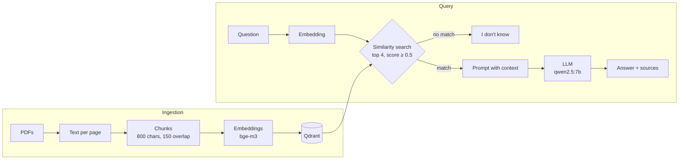

# rag-docs-local

Local RAG (Retrieval-Augmented Generation) assistant for technical documentation of a manufacturing plant.
Ask a question in Czech or English and get an answer **based only on your PDFs**, with the **document and page** it came from.

Everything runs **on-premise**: no data leaves the machine.

---

## Features

- **100 % local**: LLM and embeddings run on [Ollama](https://ollama.com); no external API calls.
- **Source citations**: every answer returns the document, page and similarity score.
- **"I don't know" instead of hallucinating**: if no fragment is similar enough, the system says the information is not in the documentation, without calling the LLM.
- **Multilingual**: a question in Czech finds the answer in an English document (`bge-m3` embeddings).
- **REST API** with FastAPI, input validation and automatic documentation at `/docs`.

## How it works



1. **Ingestion** (`src/ingest.py`): reads every PDF page by page, splits the text into overlapping chunks, converts them into vectors and stores them in Qdrant with their document and page.
2. **Query** (`src/rag.py`): converts the question into a vector, retrieves the most similar chunks, discards those below the similarity threshold and asks the LLM to answer **only** from that context.
3. **API** (`src/api.py`): exposes the query through `POST /ask`.

## Tech stack

| Component       | Choice                  | Why                                               |
| --------------- | ----------------------- | ------------------------------------------------- |
| Language        | Python 3.12             |                                                   |
| LLM             | `qwen2.5:7b` via Ollama | Runs locally on an 8 GB GPU, handles Czech        |
| Embeddings      | `bge-m3` via Ollama     | Multilingual, 1024-dimensional vectors            |
| Vector database | Qdrant (local mode)     | Same code works against a Qdrant server in Docker |
| PDF parsing     | `pypdf`                 |                                                   |
| API             | FastAPI + Pydantic      | Validation and OpenAPI docs out of the box        |

No RAG framework (LangChain, LlamaIndex) is used on purpose, to keep every step explicit.

## Project structure

```
rag-docs-local/
├── data/docs/          # PDFs to index
├── src/
│   ├── config.py       # all settings in one place
│   ├── ingest.py       # PDFs → chunks → embeddings → Qdrant
│   ├── rag.py          # search + prompt + answer (also a CLI)
│   └── api.py          # FastAPI app
├── requirements.txt
└── README.md
```

## Getting started

### Requirements

- Python 3.10+
- [Ollama](https://ollama.com/download)
- A GPU with ~8 GB VRAM is recommended (it also runs on CPU, more slowly)

### Installation

```bash
ollama pull qwen2.5:7b
ollama pull bge-m3

python -m venv venv
# Windows
.\venv\Scripts\Activate.ps1
# Linux / macOS
source venv/bin/activate

pip install -r requirements.txt
```

### Usage

**1. Index the documents** (put your PDFs in `data/docs/` first):

```bash
python -m src.ingest
```

**2a. Ask from the terminal:**

```bash
python -m src.rag
```

**2b. Or start the API:**

```bash
uvicorn src.api:app
```

Open <http://127.0.0.1:8000/docs> to try it from the browser.

> Qdrant in local mode locks its folder: stop the API before running the ingestion again.

## API

### `POST /ask`

```bash
curl -X POST http://127.0.0.1:8000/ask \
  -H "Content-Type: application/json" \
  -d '{"question": "Jaký olej se používá v lisu HP-400?"}'
```

Response:

```json
{
  "answer": "V lisu HP-400 se používá hydraulický olej třídy HLP 46 podle normy DIN 51524-2.",
  "sources": [
    { "source": "navod_lis_HP-400.pdf", "page": 1, "score": 0.621 },
    { "source": "navod_lis_HP-400.pdf", "page": 2, "score": 0.607 },
    { "source": "navod_lis_HP-400.pdf", "page": 1, "score": 0.557 }
  ]
}
```

The question must be 3–500 characters long; otherwise the API returns `422`.

### `GET /health`

Returns `{"status": "ok"}`. Intended for monitoring / container health checks.

## Configuration

All settings live in `src/config.py`:

| Setting         | Default      | Description                                                   |
| --------------- | ------------ | ------------------------------------------------------------- |
| `LLM_MODEL`     | `qwen2.5:7b` | Model that writes the answer                                  |
| `EMBED_MODEL`   | `bge-m3`     | Model that turns text into vectors                            |
| `CHUNK_SIZE`    | `800`        | Max characters per chunk                                      |
| `CHUNK_OVERLAP` | `150`        | Characters repeated between consecutive chunks                |
| `TOP_K`         | `4`          | Chunks retrieved per question                                 |
| `MIN_SCORE`     | `0.5`        | Minimum cosine similarity; below it the answer is "not found" |

## Design decisions

- **Local models**: documentation of a production plant should not leave the company network, and there is no cost per query.
- **Chunks per page**: each chunk keeps its page number, which makes citations possible.
- **Cosine similarity**: compares the direction of the vectors (the topic), not their length; the standard choice for text.
- **Two safeguards against hallucinations**: a similarity threshold before calling the LLM, and a system prompt that only allows answers from the given context. Temperature is set to 0.
- **Qdrant instead of Chroma**: Chroma crashed on Windows with a native access violation while writing; Qdrant's local mode is pure Python and the same client works against a Qdrant server.

## Test documents

The PDFs in `data/docs/` are **fictional** documents created for testing (a hydraulic press manual, CNC alarm codes and an assembly line regulation). They contain specific invented values, so a correct answer proves it comes from the documents and not from the model's general knowledge.

## Limitations

- Chunks are split by characters and may cut words or sentences.
- Tables in PDFs lose their structure; scanned PDFs would need OCR.
- A 7B model sometimes makes grammatical mistakes in Czech.
- Qdrant local mode is meant for a single process, not for production load.
- No access control: every user can query every document.

## Roadmap

- [ ] Evaluation set: questions with the expected document/page, measuring retrieval hit rate and correct "not found" answers; use it to tune `CHUNK_SIZE` and `MIN_SCORE`
- [ ] Sentence- or section-aware chunking
- [ ] Incremental ingestion (only new or changed files, using a file hash)
- [ ] Docker Compose with API + Qdrant server + Ollama
- [ ] Access control per department
- [ ] Integration with databases / MES (read-only text-to-SQL)
